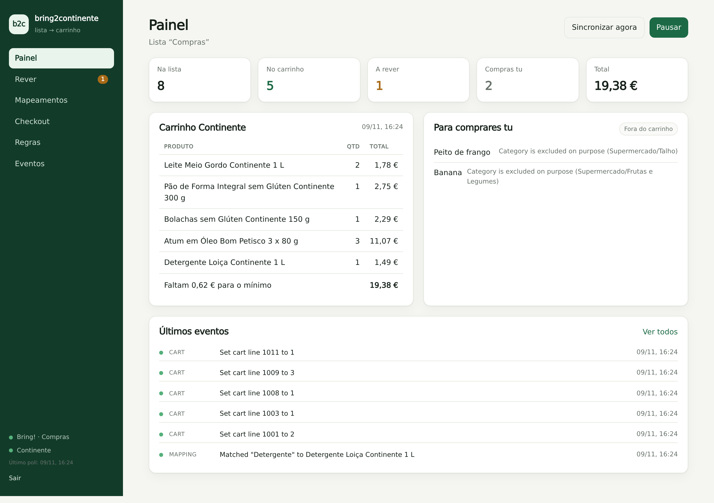
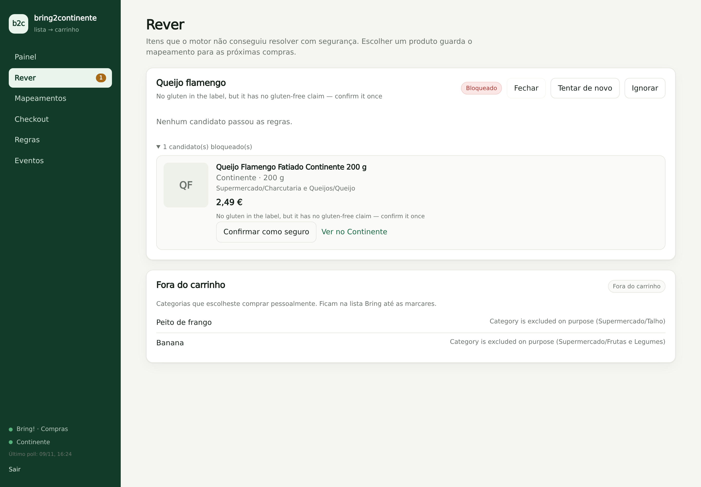

# bring2continente

[](https://github.com/Coder266/bring2continente/actions/workflows/ci.yml)

**A Bring! shopping list that fills a Continente Online cart — with dietary and quality guardrails.**

My household plans groceries in [Bring!](https://www.getbring.com/) and orders them from
[Continente Online](https://www.continente.pt/). Keeping both lists in sync by hand is
tedious and easy to get wrong. This service watches a Bring! list, resolves each item to a
Continente product, and mirrors additions and removals into the cart.

It is intentionally **not** a blind mirror:

- **Coeliac-safe by default.** A product only enters the cart if Continente marks it
  gluten-free, its name says so, or its label has no gluten and no "may contain" warning —
  and even then, only after I confirm it once. Unknown labels fail closed.
- **Meat, fish and fresh produce are never added.** Those are quality calls I want to make
  myself; I use the Bring! list as the butcher/fishmonger/greengrocer list after checkout.
- **Checkout checks the list off.** When a new Continente order appears, the items that were
  in the cart are marked as done in Bring!, leaving only the things I still have to buy in
  person.

The interesting part is not the plumbing. It is the **policy engine and the mapping memory**:
every resolved item becomes an auditable rule, and a wrong pick is one click away from being
fixed.

> Unofficial, personal-use automation. It drives Bring!'s undocumented API and Continente
> through [`continentept-mcp`](https://github.com/andredelgado/continente-mcp), which automates
> the public website with a browser. It can break when either site changes. It never places an
> order or pays. See [Safety and limitations](#safety-and-limitations).

<p align="center">
  
</p>

---

## What it looks like

```
┌──────────────── Bring! ────────────────┐        ┌──────── Continente ────────┐
│ Leite · 2                              │        │ Leite Meio Gordo 1 L   ×2  │
│ Pão de forma                           │        │ Pão de Forma s/ Glúten ×1  │
│ Peito de frango                        │  ───▶  │ Bolachas s/ Glúten     ×1  │
│ Banana                                 │        │ Atum em óleo           ×3  │
│ Queijo flamengo                        │        │ Queijo Flamengo        ×1  │
└────────────────────────────────────────┘        └────────────────────────────┘
        ▲                                                     │
        │  checkout: check off the 5 mirrored items           │
        └─────────────────────────────────────────────────────┘
   Peito de frango and Banana stay on the list — they are the
   butcher/fishmonger/greengrocer run.
```

The web UI has six screens: **Painel** (status, cart, actions), **Rever** (candidate picker
for ambiguous items), **Mapeamentos** (the memory), **Checkout** (confirm the Bring! cleanup),
**Regras** and **Eventos**.

## Architecture

```
Bring! v2 API ──(30 s poll, ETag)──▶ diff engine ──▶ resolver ──▶ policy gate ──▶ cart writer
                                        │              │             │                │
                                     SQLite        search +       gluten +        continentept-mcp
                                   (state,        score +          category         (MCP over stdio,
                                    mappings)     model           rules            Playwright)
                                        │
                                        ├──▶ review queue / ntfy
                                        └──▶ checkout detector ──▶ put `/bringlists/{id}/items`
```

The code is a small TypeScript service with no framework magic:

| Layer             | Responsibility                                                               |
| ----------------- | ---------------------------------------------------------------------------- |
| `src/bring/`      | Typed Bring! v2 client: auth, refresh, ETag, snapshot, batch complete/remove |
| `src/continente/` | MCP stdio client + tolerant normalisation of `continentept-mcp` results      |
| `src/policy/`     | The gluten gate and the category blocklist — the safety-critical part        |
| `src/matcher/`    | Normalisation, scored candidates, optional LLM tie-breaker                   |
| `src/sync/`       | Delta engine, intent log, cart writes, suppression, checkout                 |
| `src/store/`      | SQLite schema and repositories (`node:sqlite`)                               |
| `src/web/`        | Fastify API with a password/session gate                                     |
| `web/`            | React + Vite UI                                                              |

### Why delta sync?

Reconciling the whole list on every poll fights the human. This engine applies **events**:

- A Bring! item appears → add `multiplier` units to the current cart quantity (never
  overwriting something you added by hand).
- An item disappears → subtract its contribution; remove the line at zero.
- If you edit a line in Continente (remove it or lower the quantity), the engine records a
  **suppression** and stops resurrecting it on unrelated changes. `Reconciliar` is the explicit
  override.
- Checkout is naturally safe: ordering empties the cart, but the Bring! list did not change,
  so no delta fires.

Every cart write is recorded as an **intent** before the call and verified afterwards, so a
crash or a browser timeout cannot double-add silently.

## The matching pipeline

1. **Normalise** the item (`Pão de forma` → `pao forma`): accents, plurals, stopwords.
2. **Lookup** the mapping memory. Hits are re-verified after 30 days (formulations change).
3. **Search** Continente for the item and for `"<item> sem glúten"`; rank by token overlap,
   head-noun position, brand, pack unit and history.
4. **Policy gate** each candidate. A candidate without a gluten-free claim and without a
   verified label is held, not guessed.
5. **Decide**: above the confidence threshold _and_ clear of the runner-up → add.
   Otherwise ask the model, constrained to the already-safe candidates. Still unsure → review
   queue + one ntfy notification.
6. **Persist** the mapping. Fixing a wrong pick in the UI searches again, swaps the cart line,
   and teaches the engine for next week.

The model is optional. The default is deterministic and offline; when enabled it can only pick
from candidates that already passed the safety gate. The default model is OpenCode Zen's free
`opencode/big-pickle` — no paid model is used unless you change `LLM_MODEL`.

<p align="center">
  
</p>

## Safety model

**Gluten-free (hard gate, fails closed).**

| Evidence                                                                     | Verdict            | Action          |
| ---------------------------------------------------------------------------- | ------------------ | --------------- |
| Continente's `sem_gluten` badge on the product page                          | `certified`        | add             |
| `sem glúten` in the product name                                             | `certified`        | add             |
| Label has no gluten source and no may-contain warning, confirmed by you once | `naturally_gf`     | add             |
| Ingredients mention wheat/barley/rye/oats/malt…                              | `risk`             | never           |
| "Pode conter vestígios de glúten"                                            | `risk` in `strict` | never           |
| No label data, or no claim and not confirmed                                 | `unknown`          | hold for review |

The ingredient scanner understands Portuguese labels, ignores gluten-free claims and
false friends (`trigo sarraceno` is buckwheat), and distinguishes "may contain milk" from
"may contain gluten". In strict mode, a trace warning blocks. There is no fallback path from
"no gluten-free product found" to a product that contains gluten.

**Category blocklist (prefix-based).**

```
Supermercado/Talho                 → never
Supermercado/Peixaria              → never
Supermercado/Frutas e Legumes      → never (fresh)
Supermercado/Congelados/...        → still allowed
Supermercado/Charcutaria e Queijos → still allowed
```

Non-food categories (cleaning, hygiene, pets…) bypass the dietary gate, otherwise a Bring!
item "detergente" would be held forever.

**Operational rails.** Dry-run mode, a cart budget cap, one notification per unresolved item
per day, exponential backoff on Bring! failures, and a pause switch. The service never calls a
checkout tool; `continentept-mcp` blocks order submission and payment anyway.

## Quick start

### Demo, no accounts

```bash
npm install
npm run build
DEMO=1 npm start        # http://127.0.0.1:8093 — password: demo
```

The demo seeds a list and a small Continente catalogue, including deliberately tricky items:
regular vs gluten-free bread, flavoured vs plain milk, butcher/fish/produce items, a cheese
that needs one confirmation. Add items and press **Simular pedido** to watch the checkout flow.

### Real accounts

Requirements: **Node.js ≥ 24** (for `node:sqlite`) and Chromium for
`continentept-mcp` (`npx continentept-mcp install-browser`).

```bash
cp .env.example .env
# edit BRING_*, CONTINENTE_*, WEB_PASSWORD, SESSION_SECRET
set -a; . ./.env; set +a

npm install
npx continentept-mcp login     # opens a browser once; completes "não sou um robô"
npm run build
npm start
```

Start in `DRY_RUN=1` for a few days if you want to see the decisions without writing to the
cart. The first week will produce a handful of review items; that is normal. After that the
mapping memory does the work.

> **Headless servers:** Continente may occasionally ask for a robot check on re-login, and
> `continentept-mcp` answers that by opening a desktop window. The service keeps the session
> warm with periodic cart reads, but if it expires you will need to run `continentept-mcp login`
> somewhere with a display (or copy `CONTINENTE_DATA_DIR` from a machine where you did).

## Configuration

Everything is environment-driven; see [`.env.example`](.env.example) for the full list.

| Variable                  | Default                            | Notes                                                 |
| ------------------------- | ---------------------------------- | ----------------------------------------------------- |
| `DEMO`                    | `0`                                | Fake Bring!/Continente adapters, safe to click around |
| `DRY_RUN`                 | `0`                                | Resolve and log, never write to the cart              |
| `BRING_LIST`              | —                                  | List name or UUID                                     |
| `GLUTEN_MODE`             | `strict`                           | `strict` / `standard` / `off`                         |
| `EXCLUDED_CATEGORIES`     | butcher, fishmonger, fresh produce | Comma-separated prefixes                              |
| `AUTO_ADD_THRESHOLD`      | `0.72`                             | Minimum score for an automatic match                  |
| `AUTO_ADD_MARGIN`         | `0.12`                             | Minimum lead over the runner-up                       |
| `LLM_PROVIDER`            | `none`                             | `opencode` or any OpenAI-compatible endpoint          |
| `LLM_MODEL`               | `opencode/big-pickle`              | Free by default; only safe candidates are offered     |
| `ON_COMPLETE`             | `remove`                           | What checking a Bring! item off does to the cart      |
| `CHECKOUT_MODE`           | `ask`                              | `ask`, `auto`, `off`                                  |
| `MAX_CART_EUR`            | `200`                              | Refuse a batch that would exceed this                 |
| `WEB_PASSWORD`            | —                                  | UI login                                              |
| `SESSION_SECRET`          | —                                  | HMAC key for the session cookie (≥ 24 chars)          |
| `NTFY_URL` / `NTFY_TOPIC` | —                                  | Optional push notifications                           |

## Deployment

### Docker

```bash
docker build -t bring2continente .
docker run --rm -p 8093:8093 --env-file .env \
  -v "$PWD/data:/data" \
  -v "$PWD/continente:/continente" \
  bring2continente
```

Set `DATA_DIR=/data` and `CONTINENTE_DATA_DIR=/continente` in `.env`. The image includes
Chromium for the MCP server.

### NixOS

The flake exposes the package and a NixOS module:

```nix
{
  inputs.bring2continente.url = "github:Coder266/bring2continente";

  services.bring2continente = {
    enable = true;
    package = inputs.bring2continente.packages.${pkgs.system}.default;
    environmentFile = "/etc/bring2continente/env";
    port = 8093;
  };
}
```

`environmentFile` holds the secrets from `.env.example`. Put the UI behind Tailscale Serve or
another reverse proxy and set `SECURE_COOKIES=1` plus `PUBLIC_URL` for notification links.

## Safety and limitations

- **This is not medical advice.** Continente's badge and label text are the evidence the
  service has; packaging and formulations change. Always read the package, especially for a
  coeliac household.
- Both APIs are unofficial. Bring! can change its endpoints; Continente can change its HTML.
  The adapter boundary and the health panel exist to make that visible and fixable.
- The MCP server runs a real browser. It is slower than an API and occasionally needs a human
  for a robot check.
- No checkout, no payment, no delivery-slot selection. That stays in the Continente app.
- Rate limits: Bring! is polled with ETags (mostly `304`s); Continente is touched only when
  something changes, plus a five-minute cart health read.
- Do not deploy this for other people's accounts. It is a personal automation with personal
  credentials.

## Development

```bash
npm run dev          # Fastify on :8093 + Vite on :5173
npm test             # 42 unit/integration tests, no network
npm run typecheck
npm run lint
```

The test suite uses the demo adapters and a fake product-page fetcher, so it covers the full
sync path (matching, policy, cart writes, suppression, checkout) without touching either
website.

## Roadmap

- [ ] Import a seed mapping file from past Continente orders
- [ ] Price watch / "this went up 30%" alerts
- [ ] Per-item quantity language beyond a leading number (`2 kg`, `meio`)
- [ ] Better handling of weighted products (currently excluded by design)
- [ ] Optional Telegram notifier

## License

MIT. Not affiliated with Bring! Labs AG or MC Sonae / Continente.
